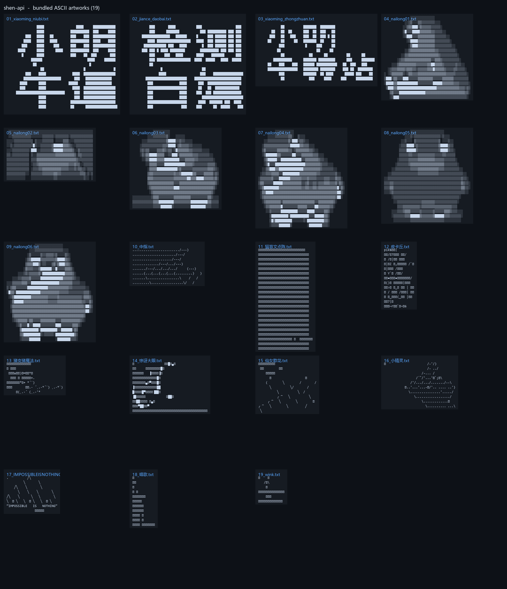
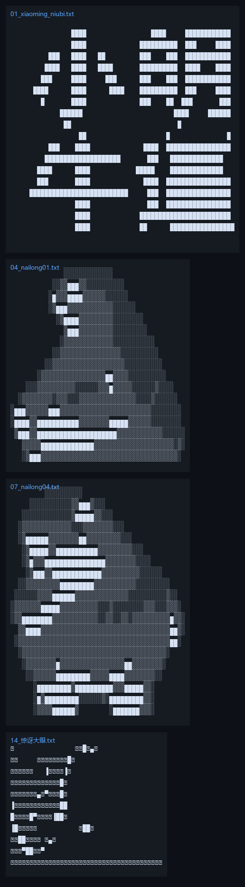

# shen-api

假 AI 接口（Fake AI API）。协议完全兼容 OpenAI / Anthropic，但任何请求的回答都是 `ascii/` 目录里随机一份字符画。

接口层面全是真的，模型层面全是假的 —— 你问什么，它给你画一张图。



## 这是什么

一个整蛊用的小玩具。它以真实的协议形态提供服务：

- `/v1/models` 返回模型列表
- `/v1/chat/completions`、`/v1/completions`、`/v1/responses` 正常响应
- `/v1/messages`、`/v1/messages/count_tokens` 兼容 Anthropic
- 流式输出（SSE）正常，带打字机节奏

但模型不产生任何真实推理：每次从 `ascii/` 目录随机挑一份字符画返回。用在支持自定义 API 地址的客户端里（Cherry Studio、Chatbox、Claude Code、Codex 等），看起来一切正常，只是"AI"永远在画画。

## 效果



## 特性

- **零依赖**：只用 Python 标准库，单文件约 200 行
- **双协议**：OpenAI 与 Anthropic 两套接口同时兼容
- **流式输出**：SSE 按行分片，可调打字速度
- **素材加权随机**：可配置某类素材的出场权重，比如让某类图占七成
- **换素材零成本**：往 `ascii/` 丢 txt 文件即可，不用改代码
- **轻量**：常驻内存约 15MB，单核 1G 的机器绰绰有余

## 快速开始

```bash
git clone https://github.com/xm2284/shen-api.git
cd shen-api
python3 server.py
```

默认监听 `127.0.0.1:3999`。验证：

```bash
curl http://127.0.0.1:3999/health
curl -X POST http://127.0.0.1:3999/v1/chat/completions \
  -H "Content-Type: application/json" \
  -d '{"model":"shen-1","messages":[{"role":"user","content":"你好"}]}'
```

## 配置

所有配置集中在 `config.json`：

| 字段 | 说明 |
| --- | --- |
| `listen` / `port` | 监听地址与端口 |
| `api_key` | 访问密钥，`require_auth` 为 true 时校验 |
| `require_auth` | 是否校验请求头里的密钥 |
| `wrap_code_block` | 是否用 markdown 代码块包裹字符画，**建议保持 true**（见下文） |
| `stream_delay_ms` | 流式输出每行的间隔毫秒数 |
| `models` | `/v1/models` 返回的模型列表 |
| `tail` | 附在每次回答末尾的文案，放在代码块外 |
| `weights` | 素材权重，按**文件名匹配**，如 `{"nailong": 6}` |
| `default_weight` | 未命中任何权重规则的素材的默认权重 |

## 素材

素材是 `ascii/` 下的 `.txt` 文件，每份就是一张图的完整文本。新增只要丢文件进目录，重启服务即可。

权重按文件名前缀匹配，用来控制出场概率：

```json
{
  "weights": { "nailong": 6 },
  "default_weight": 1
}
```

上例中，文件名含 `nailong` 的 6 份素材每份权重 6，其余每份权重 1，那么奶龙类素材的出场率约为 73%（`6×6 / (6×6 + 13×1)`）。

设为 0 可以临时禁用某份素材。`/health` 接口会列出每份素材的实际权重，方便核对。

## 接入 New API

在 New API 里新建渠道：

| 项 | 值 |
| --- | --- |
| 类型 | OpenAI 兼容 |
| Base URL | `http://127.0.0.1:3999` |
| 密钥 | 与 `config.json` 的 `api_key` 一致 |
| 模型 | 与 `config.json` 的 `models` 一致 |
| 分组 | 建议放独立分组，倍率设为 0（不扣费） |

放在独立分组的好处是：普通分组的用户调用会得到 `No available channel`，只有切到该分组的人才会收到字符画，不会误伤正常使用。

## 部署为系统服务

`deploy/shen-api.service`：

```ini
[Unit]
Description=Shen API (fake AI)
After=network.target

[Service]
Type=simple
WorkingDirectory=/opt/shen-api
ExecStart=/usr/bin/python3 /opt/shen-api/server.py
Restart=always
RestartSec=3

[Install]
WantedBy=multi-user.target
```

```bash
sudo cp deploy/shen-api.service /etc/systemd/system/
sudo systemctl daemon-reload
sudo systemctl enable --now shen-api
```

## 几个容易踩的坑

这些都是实际部署时撞出来的，记下来省事。

**1. 必须用 markdown 代码块包裹字符画。** 客户端对普通文本会合并连续空格、自动折行，一条 `@` 排出来的图会碎成一片。`wrap_code_block` 为 true 时用 ``` 包住，客户端才会按等宽渲染、保留空格。

**2. 字符画宽度控制在 60 列以内。** 再宽在聊天窗口里会折行，一折字形就毁了。

**3. 宽高比要按目标客户端的字体算。** 字符在浏览器里不是正方形。以 New API 游乐场为例，它的代码块样式是 `font-mono text-sm leading-6`，即 Consolas 14px 字号、24px 行高，实测半角字宽 8px，所以字形的实际高宽比是 `24 / 8 = 3`。生成字符画时高度要按 `1/3` 压缩，否则图会被拉长。换客户端就得重算：

```
目标行数 = 图片高宽比 × 列数 × (字宽 / 行高)
```

**4. Python 3.6 没有 `http.server.ThreadingHTTPServer`。** 那是 3.7 才加的，3.6 上要用 `class ThreadedHTTPServer(socketserver.ThreadingMixIn, HTTPServer)`。

**5. 灰度字符画不适合直接发给人看。** 用 `@%#*+=-:.` 模拟明暗的字符画必须远看或缩小才能合成字形，在 14px 字号下就是一片符号。改用块字符 `█▒░` 效果好得多；文字类素材再给字体加描边，避免细笔画断线。

## 出处

本项目受 [XTxiaoting14332/fake-ai-api](https://github.com/XTxiaoting14332/fake-ai-api)（GPL-3.0）启发，`ascii/` 中的部分素材亦来自该项目。在此基础上的改动：

- 服务端用 Python 标准库重写，去掉 Node 运行时依赖
- 素材扩充为字符画、文字点阵、表情等多类
- 增加素材加权随机
- 补充部署脚本与踩坑记录

## License

GPL-3.0
