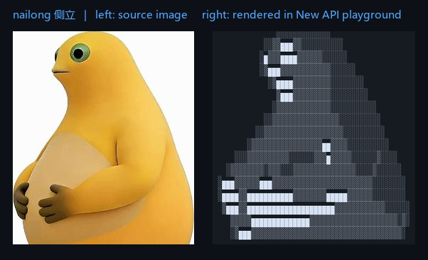
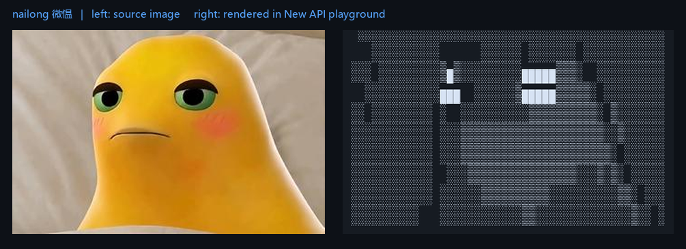
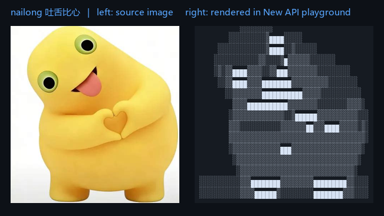
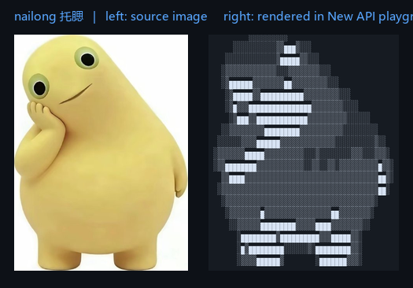
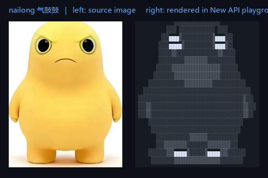
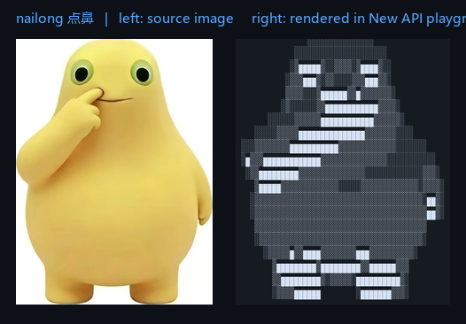

<div align="center">

# 「小明」神 API (shen-api)

**假 AI 接口 —— 协议全是真的，回答全是字符画**

*兼容 OpenAI / Anthropic 双协议 · 零依赖单文件 · 素材加权随机 · 常驻内存 15MB*

<p align="center">
  
  
  
  
  
  <a href="https://github.com/xm2284/shen-api/stargazers">
    
  </a>
</p>

<p align="center">
  <a href="#这是什么">这是什么</a> ·
  <a href="#效果">效果</a> ·
  <a href="#关于奶龙素材">奶龙素材</a> ·
  <a href="#逐张对比">逐张对比</a> ·
  <a href="#特性">特性</a> ·
  <a href="#快速开始">快速开始</a> ·
  <a href="#接入-new-api">接入 New API</a> ·
  <a href="#踩坑记录">踩坑记录</a>
</p>

</div>

---

## 这是什么

一个整蛊用的小玩具。

它把接口层做得完全真实：`/v1/models` 返回模型列表、`/v1/chat/completions` 正常响应、流式输出带着打字机节奏、错误码也照着官方格式编。任何支持自定义 API 地址的客户端（Cherry Studio、Chatbox、Claude Code、Codex 等）都能正常接上，`curl` 也挑不出毛病。

但模型不产生任何真实推理 —— 每次请求都从 `ascii/` 目录随机挑一份字符画返回。

接入别人的客户端之后，对方会发现自己花半天配好的"AI"，不管问什么都在画画。

> 接口是真的，模型是假的。这就是全部。

---

## 效果

素材总览（19 份，含字符画、文字点阵、表情三类）：


在 New API 游乐场里的实际渲染效果：


---

## 关于奶龙素材

`ascii/` 里的 6 份奶龙字符画是本项目的主打素材，也是默认权重最高的一类。

**奶龙**是深圳第七印象文化传媒出品的国产原创动漫 IP，形象是一条圆头圆脑、憨厚贪吃的黄色小龙。它从短视频平台走红，"我是奶龙"相关内容的播放量超过 34 亿次，IP 授权覆盖 57 个国家和地区，后来延伸出番剧、大电影、线下主题乐园和 AI 陪伴玩具等业态，是近年国产动漫 IP 里商业化比较完整的一个。

**奶蛙**是这一形象在社区里的衍生变体 —— 网友在奶龙的基础上用 AI 重新演绎，形体更圆、表情更夸张，随后派生出"大笑奶龙"等一批二创梗图，成为 2026 年初流行起来的网络模因。

本项目这 6 份素材取自 [Nailong-Studio/wallpaper](https://github.com/Nailong-Studio/wallpaper) 的奶蛙馆藏库，经过灰度映射与块字符化转换后生成，覆盖侧立、微愠、吐舌比心、托腮、气鼓鼓、点鼻六个姿势。

---

## 逐张对比

下面是每份素材的转换效果：**左边是源图，右边是在 New API 游乐场里的实际渲染**（Consolas 14px 字号、24px 行高）。

### 侧立



### 微愠



### 吐舌比心



### 托腮



### 气鼓鼓



### 点鼻



---

## 特性

| 特性 | 说明 |
| :--- | :--- |
| 零依赖 | 只用 Python 标准库，不需要 pip install 任何东西 |
| 单文件 | 服务本体约 200 行，一个 `server.py` 就是全部 |
| 双协议 | OpenAI（chat / completions / responses）与 Anthropic（messages）同时兼容 |
| 流式输出 | SSE 按行分片，打字速度可调 |
| 素材加权 | 可配置某类素材的出场权重，比如让某一类占七成 |
| 换素材零成本 | 往 `ascii/` 丢 txt 文件即可，不碰代码 |
| 轻量 | 常驻内存约 15MB，单核 1G 的机器跑起来毫无压力 |

---

## 快速开始

```bash
git clone https://github.com/xm2284/shen-api.git
cd shen-api
python3 server.py
```

默认监听 `127.0.0.1:3999`。

验证：

```bash
curl http://127.0.0.1:3999/health

curl -X POST http://127.0.0.1:3999/v1/chat/completions \
  -H "Content-Type: application/json" \
  -d '{"model":"shen-1","messages":[{"role":"user","content":"你好"}]}'
```

### 自测清单

| 端点 | 用途 |
| :--- | :--- |
| `GET /health` | 健康检查，同时列出每份素材的实际权重 |
| `GET /v1/models` | 模型列表 |
| `POST /v1/chat/completions` | OpenAI 聊天补全（支持 stream） |
| `POST /v1/completions` | OpenAI 传统补全 |
| `POST /v1/responses` | OpenAI Responses API（Codex） |
| `POST /v1/messages` | Anthropic Messages（Claude Code） |

---

## 配置

所有配置集中在 `config.json`：

| 字段 | 默认值 | 说明 |
| :--- | :--- | :--- |
| `listen` / `port` | `127.0.0.1` / `3999` | 监听地址与端口 |
| `api_key` | `sk-shen-0000` | 访问密钥 |
| `require_auth` | `false` | 是否校验请求头里的密钥 |
| `wrap_code_block` | `true` | 用 markdown 代码块包裹字符画，**建议保持开启**（原因见踩坑记录） |
| `stream_delay_ms` | `8` | 流式输出每行的间隔毫秒数 |
| `models` | `["shen-1", ...]` | `/v1/models` 返回的模型列表 |
| `tail` | — | 附在每次回答末尾的文案，会放在代码块外面 |
| `weights` | `{}` | 素材权重，按文件名匹配，如 `{"nailong": 6}` |
| `default_weight` | `1` | 未命中权重规则的素材的默认权重 |

---

## 素材

素材就是 `ascii/` 下的 `.txt` 文件，每份是一张图的完整文本。新增只要丢文件进目录，重启服务即可。

### 权重怎么算

权重按**文件名匹配**，命中的第一条规定即生效：

```json
{
  "weights": { "nailong": 6 },
  "default_weight": 1
}
```

上例中文件名含 `nailong` 的 6 份素材每份权重 6，其余 13 份每份权重 1，那么奶龙类的出场率为：

```
6 × 6 / (6 × 6 + 13 × 1) = 73.5%
```

实测抽样 300 次，奶龙占比 76.0%，符合预期。

把某份素材的权重设为 `0` 可以临时禁用；`/health` 会列出每份素材的实际权重，方便核对。

### 素材类型

| 前缀 | 类型 | 数量 | 说明 |
| :--- | :--- | :--- | :--- |
| `01`–`03` | 文字点阵 | 3 | 汉字转块字符，用于站务文案 |
| `04`–`09` | 奶龙系列 | 6 | 主力素材，默认权重最高 |
| `10`–`19` | 表情与梗图 | 10 | 中指、皮卡丘、仙女散花等 |

---

## 接入 New API

在 New API 里新建渠道：

| 项 | 值 |
| :--- | :--- |
| 类型 | OpenAI 兼容 |
| Base URL | `http://127.0.0.1:3999` |
| 密钥 | 与 `config.json` 的 `api_key` 一致 |
| 模型 | 与 `config.json` 的 `models` 一致 |
| 分组 | 建议放独立分组，倍率设为 `0`（不扣费） |

放在独立分组有两个好处：普通分组的用户调用时会拿到 `No available channel`，不会误伤正常使用；同时该模型也不会计入用户的额度消耗。

---

## 部署为系统服务

`deploy/shen-api.service`：

```ini
[Unit]
Description=Shen API (fake AI)
After=network.target

[Service]
Type=simple
WorkingDirectory=/opt/shen-api
ExecStart=/usr/bin/python3 /opt/shen-api/server.py
Restart=always
RestartSec=3

[Install]
WantedBy=multi-user.target
```

```bash
sudo cp deploy/shen-api.service /etc/systemd/system/
sudo systemctl daemon-reload
sudo systemctl enable --now shen-api
systemctl status shen-api
```

---

## 踩坑记录

这些都是实际部署时撞出来的，记下来省事。

### 1. 必须用 markdown 代码块包裹字符画

客户端渲染普通文本时会合并连续空格、自动折行，一条 `@` 排出来的图会碎成一片。`wrap_code_block` 为 `true` 时用 ``` 包住，客户端才会按等宽渲染并保留空格。

这是最容易被忽略、后果最严重的一条 —— 不加代码块，所有素材都白做。

### 2. 字符画宽度控制在 60 列以内

再宽会在聊天窗口里折行，一折字形就毁了。折行不是"换行显示"，而是把一整行拦腰切断，图形直接错位。

### 3. 宽高比要按目标客户端的字体算

字符在浏览器里不是正方形。以 New API 游乐场为例，它的代码块样式是 `font-mono text-sm leading-6`，解析下来是 Consolas 14px 字号、24px 行高，实测半角字宽 8px。也就是说字形的实际高宽比是：

```
24 / 8 = 3
```

生成字符画时高度要按 `1/3` 压缩，否则图会被竖着拉长。换客户端就得重算：

```
目标行数 = 图片高宽比 × 列数 × (字宽 / 行高)
```

验证方法：拿原图（裁掉留白后）的高宽比，和字符画渲染后的 `行数 × 高宽比 ÷ 列数` 对比，偏差控制在 5% 以内即可。**别靠肉眼估，一估就错。**

### 4. Python 3.6 没有 `http.server.ThreadingHTTPServer`

那是 3.7 才加的。3.6 上要自己拼：

```python
class ThreadedHTTPServer(socketserver.ThreadingMixIn, HTTPServer):
    daemon_threads = True
```

### 5. 灰度字符画不适合直接发给人看

用 `@%#*+=-:.` 模拟明暗的字符画靠"明暗对比"合成字形，必须远看或缩小才成立。在 14px 字号下它就是一片 `@@@@` 和符号，没人认得出。

改用块字符效果好得多：

- **文字类**：`█` 实心填充，再给字体加描边（`stroke_width`），避免细笔画在小点阵下断成虚线
- **图片类**：`█▒░` 三级灰阶，阈值调到背景留白，既保留五官层次又不至于糊成一片

### 6. New API 改渠道的接口路径

`PUT /api/channel/{id}` 会返回 404，正确写法是 `PUT /api/channel/`，然后在请求体里带 `id`。

---

## 出处

本项目受 [XTxiaoting14332/fake-ai-api](https://github.com/XTxiaoting14332/fake-ai-api)（GPL-3.0）启发，`ascii/` 中的部分素材亦来自该项目。

在这个基础上的改动：

- 服务端用 Python 标准库重写，去掉 Node 运行时依赖
- 素材从 2 份扩充到 19 份，覆盖字符画、文字点阵、表情三类
- 增加素材加权随机，可控制出场概率
- 增加配置化的尾部文案
- 补充 systemd 部署文件与踩坑记录

---

## License

GPL-3.0
